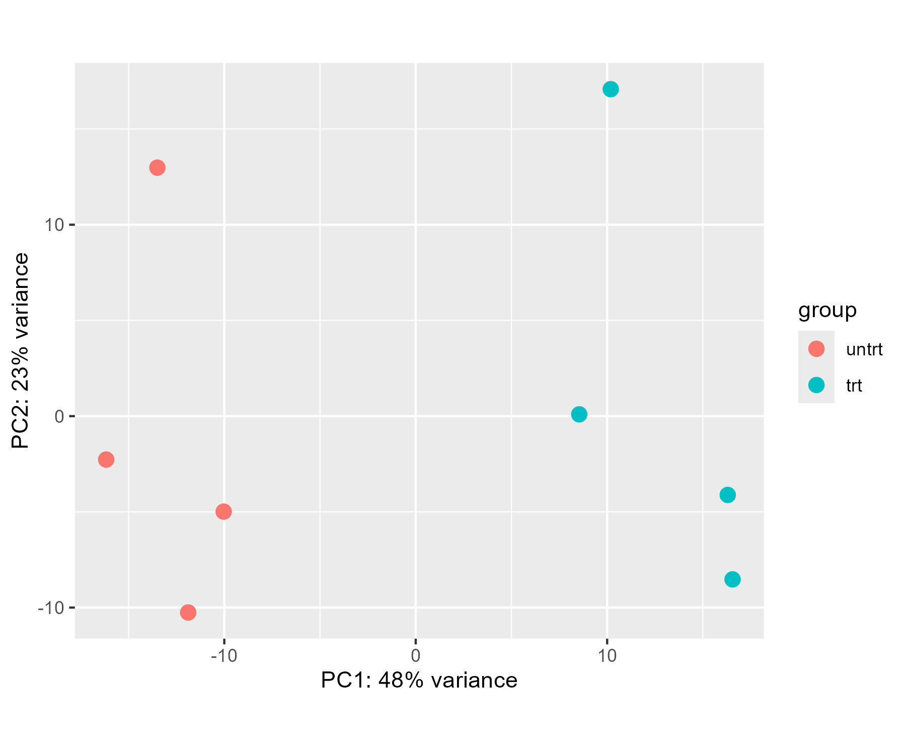
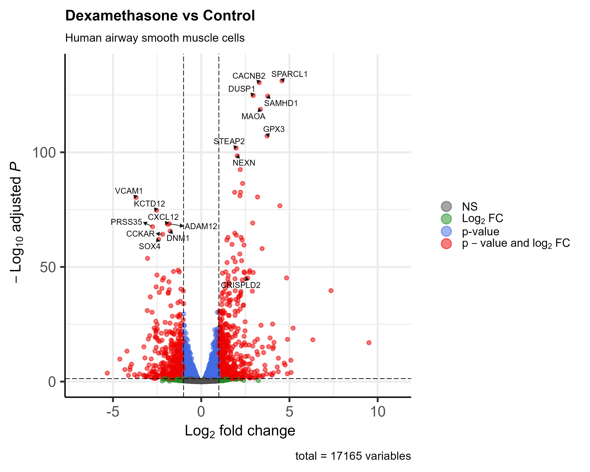
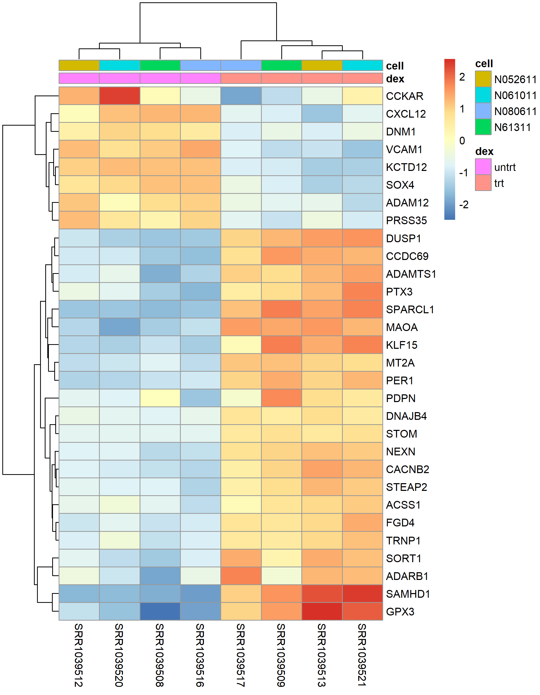

# Dexamethasone response in airway smooth muscle cells

Differential expression analysis of a public bulk RNA-seq dataset with DESeq2 in R.
I used this project to learn the standard RNA-seq workflow, from a count matrix
to a biological interpretation of the results.


## Data

Himes et al. (2014) treated primary human airway smooth muscle cells from four
donors with dexamethasone (1 µM, 18 h), a glucocorticoid used in asthma treatment.
Each donor has one treated and one untreated sample, giving 8 samples in total.

The raw data are available on GEO under
[GSE52778](https://www.ncbi.nlm.nih.gov/geo/query/acc.cgi?acc=GSE52778).
I used the preprocessed gene count matrix from the
[airway](https://bioconductor.org/packages/airway/) Bioconductor package.

## Methods

- Removed genes with fewer than 10 reads summed across all samples
- Ran DESeq2 with the design `~ cell + dex`, so the treatment effect is estimated
  within each donor
- Called genes significant at adjusted p < 0.05 (Benjamini–Hochberg)
  and |log2 fold change| > 1
- Used the variance-stabilising transformation (VST) for PCA and the heatmap
- Mapped Ensembl IDs to gene symbols with `org.Hs.eg.db`

## Results

### Samples separate by treatment



The first principal component (48% of the variance) separates treated and
untreated samples completely. The second component (23%) most likely reflects
differences between donors.

### Differentially expressed genes



519 genes were up-regulated and 480 down-regulated after treatment
(adjusted p < 0.05, at least 2-fold change).

The strongest induced genes include *SPARCL1* (~24-fold), *DUSP1*, *MT2A* and
*GPX3*. *DUSP1* and *MT2A* are well-known glucocorticoid-responsive genes, which
was a useful check that the analysis behaved as expected. Among the repressed
genes, *VCAM1* and *CXCL12* stand out: both help recruit immune cells to tissue,
so their downregulation fits the anti-inflammatory effect of glucocorticoids.

### Reproducing the main finding of the original study

The original paper highlighted *CRISPLD2* as a glucocorticoid-responsive gene.
In this analysis it is also strongly induced (log2 fold change = 2.63,
adjusted p = 7.5 × 10⁻⁴⁶).

### Top 30 genes



## Limitations

- Only four donors, so donor-level variation is hard to estimate
- Cultured cells, a single dose and a single time point; results may not
  reflect the response in patients
- No pathway or gene set enrichment analysis yet

## How to run

Requires R (≥ 4.4) and the following packages:

```r
install.packages("BiocManager")
BiocManager::install(c("DESeq2", "airway", "org.Hs.eg.db",
                       "EnhancedVolcano", "pheatmap"))
```

Open `airway-rnaseq-analysis.Rproj` in RStudio and run `scripts/analysis.R`.
Outputs are written to `results/` and `figures/`. Package versions used are listed
in `results/session_info.txt`.

## Repository structure

```
├── scripts/
│   └── analysis.R          # full analysis
├── results/
│   ├── deseq2_results.csv  # DESeq2 results for all tested genes
│   └── session_info.txt    # R and package versions
├── figures/                # PCA, volcano plot, heatmap
└── README.md
```

## References

- Himes BE, Jiang X, Wagner P, et al. RNA-Seq transcriptome profiling identifies
  CRISPLD2 as a glucocorticoid responsive gene that modulates cytokine function
  in airway smooth muscle cells. *PLoS One*. 2014;9(6):e99625.
- Love MI, Huber W, Anders S. Moderated estimation of fold change and dispersion
  for RNA-seq data with DESeq2. *Genome Biology*. 2014;15:550.
